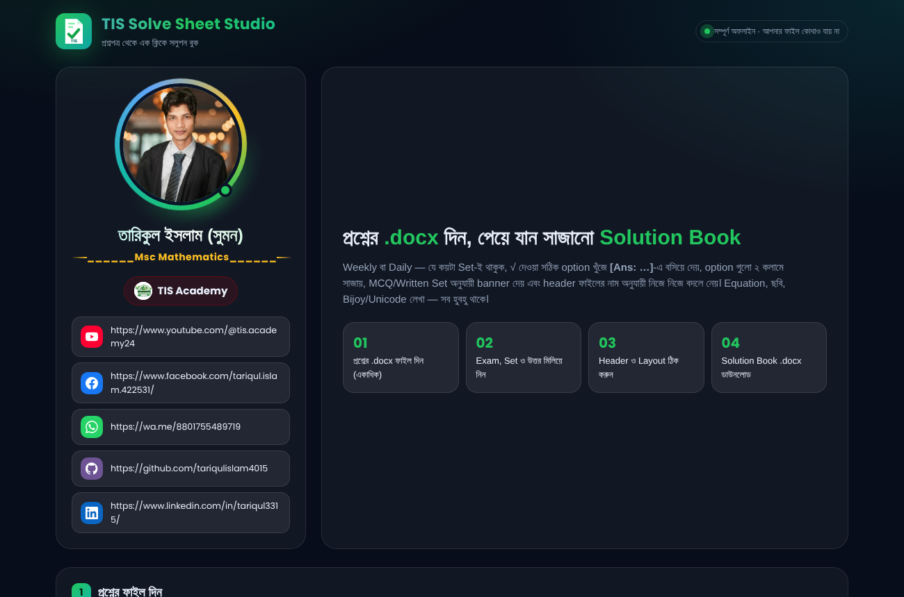

<div align="center">


# TIS Solve Sheet Studio

**প্রশ্নপত্রের `.docx` থেকে এক ক্লিকে সাজানো Solution Book `.docx`**
<br>Turn MCQ / Written exam papers (`.docx`) into a formatted Solution Book — fully offline, in the browser.

[](https://tariqulislam4015.github.io/tis-solve-sheet-studio/)




</div>

---

## ✨ কী করে (Features)

| | |
|---|---|
| ✅ **সঠিক উত্তর খোঁজে** | √ দেওয়া option খুঁজে `[Ans: …]`-এ বসায় — equation, ছবি, Bijoy (SutonnyMJ) / Unicode সব হুবহু থাকে |
| 🧹 **শুধু Ans** | সাধারণ প্রশ্নে option মুছে দেয়; কিন্তু “কোনটিই নয়” বা “a ও c উভয়ই” ধরনের option থাকলে option গুলো ২ কলামে রাখে |
| 🗂️ **Set অনুযায়ী সাজায়** | Daily: MCQ Set-A, B → Written Set-A,B,C,D · Weekly: MCQ Set-A–D → Written Set-A–D |
| 📥 **Written ৪ Set-এর আলাদা ঘর** | প্রতিটা Written Set-এ আলাদা ফাইল দেওয়া যায় (UniqueSet-1…4 নিজে থেকেও বসে) |
| 🏷️ **ফাইলের নাম থেকে Auto** | Program (EAP/MAP/VAP), সাল, Daily/Weekly, কোড (P-01, C-01, M-01, Bio-01, W-12), B.V/E.V — header ও output নাম নিজে বানায় |
| 🔎 **উত্তর যাচাই** | প্রতিটা প্রশ্নের উত্তর chip আকারে দেখায়; √ না পেলে লাল — নিজে বেছে দেওয়া যায় |
| 📄 **২ কলাম Layout** | Exam title box, Set banner, ২-কলাম পেজ, মূল Solution Book-এর footer |
| 🔒 **Private** | সব কাজ আপনার ব্রাউজারেই হয় — কোনো ফাইল কোথাও upload হয় না |

## 📘 Class 5 Solve Sheet (প্রাথমিক বৃত্তি)

App-এর উপরে **📘 Class 5 Solve Sheet** অংশে যান:

| | |
|---|---|
| 📂 **BV ও EV আলাদা গ্রুপ** | প্রতি গ্রুপে ফাইল ১ … ১০ পর্যন্ত ক্রমিক ঘর; সব ফাইল একসাথে দিলে নাম/লেখা দেখে নিজে BV-EV ভাগ করে |
| ✂️ **নম্বর বণ্টন বাদ** | “নম্বর বণ্টন / Marks Distribution” অংশ মুছে দেয়; “১ নং প্রশ্নের উত্তর / Answers to question no. 1” → **নমুনা উত্তর / Sample Answer** ব্যানার |
| 🏷️ **Set ব্যানার** | প্রতিটি ফাইলের আগে “Written Set-A/B…” (নাম থেকে Set নেয়, বদলানো যায়) |
| ✏️ **Editable** | Header, Footer, Title ব্লক, ব্যানারের লেখা, Cover (নমুনার / নিজের ছবি / ছাড়া) — সব বদলানো যায়; Word-এ header/footer-এর লেখাও edit করা যায় |
| ⬇️ **Word + PDF** | BV ও EV আলাদা আলাদা `.docx`; PDF-এর জন্য প্রিভিউ → **Save as PDF** |

> PDF সবচেয়ে ভালো দেখায় Chrome/Edge-এ, কম্পিউটারে **SolaimanLipi** font থাকলে।

## 📙 Class 8 Solve Sheet (জুনিয়র বৃত্তি)

App-এর উপরে **📙 Class 8 Solve Sheet** অংশে যান — এর Header/Footer/Cover সেটিং Class 5 থেকে আলাদা:

| | |
|---|---|
| 🔘 **MCQ (উপরে)** | UniqueSet-1 = Set-A, UniqueSet-2 = Set-B …; √ দেওয়া উত্তর খুঁজে ২ কলামে সাজায়, ডান পাশের ধূসর ফালিতে ⓐⓑⓒⓓ |
| ✍️ **Written (নিচে)** | CQ Set-A, Set-B …; নম্বর বণ্টন বাদ, “উত্তর:” → নমুনা উত্তর, “(ক) নং প্রশ্নের উত্তর:” → (ক) |
| 📂 **BV ও EV আলাদা** | প্রতিটির MCQ ও Written-এ ১…১০ ক্রমিক ঘর; একসাথে দিলে নাম দেখে নিজে ভাগ করে |
| ⬇️ **Word + PDF** | Cover → Title → MCQ Set-A, B → Written Set-A, B → পেছনের Cover |

## 🎖️ Cadet Solve Sheet (ক্যাডেট কলেজ ভর্তি)

App-এর উপরে **🎖️ Cadet Solve Sheet** অংশে যান — নিজস্ব Header/Footer/Cover সেটিং:

| | |
|---|---|
| 📂 **BV ও EV আলাদা** | প্রতিটিতে ১…১০ ক্রমিক ঘর; প্রতিটি ফাইল = একটি Set (Set-A, Set-B …) |
| 🔀 **প্রশ্ন আগে, উত্তর পরে** | প্রতিটি Set-এর সব প্রশ্ন ২ কলামে → **নমুনা উত্তর** ব্যানার → সব উত্তর ২ কলামে, প্রতিটি উত্তরের শুরুতে “০১। …” |
| ✂️ **নম্বর বণ্টন বাদ** | “নম্বর বণ্টন / Marks Distribution” ও “[বি.দ্রঃ …]” মুছে দেয় |
| 📐 **কলামে মানানসই** | পুরো পেজের জন্য দেওয়া tab-গুলো কলামের মাপে ছোট করে, নম্বর ডানে থাকে |

## 🚀 ব্যবহার (Usage)

1. **[Live App](https://tariqulislam4015.github.io/tis-solve-sheet-studio/)** খুলুন — অথবা `index.html` ডাউনলোড করে Chrome/Edge-এ খুলুন (internet লাগবে না)।
2. প্রশ্নের `.docx` ফাইল গুলো টেনে আনুন (একসাথে অনেকগুলো)।
3. Exam, Set আর উত্তর মিলিয়ে নিন; Written Set-A–D-এর ঘরে ফাইল দিন।
4. **⚡ Solution Book বানাও** চাপুন → `.docx` ডাউনলোড হবে।

> Word-এ সঠিকভাবে দেখতে কম্পিউটারে **SutonnyMJ** font থাকা লাগবে (Bijoy লেখার জন্য)।

### ফাইলের নাম যেভাবে দিলে ভালো হয়
```
EAP_Daily_MCQ_P-01_Bangla.docx           → Daily MCQ P-01 (Set-A, Set-B)
EAP_Daily_Written_P-01_Bangla.docx       → Daily Written P-01
EAP_Weekly_MCQ_Exam_W-12-UniqueSet-1Bangla.docx → Weekly W-12, Written Set-A
EAP_Weekly_MCQ_Exam_W-12-UniqueSet-2Bangla.docx → Weekly W-12, Written Set-B
```
প্রশ্নপত্রের ভেতরে `Set-B`, `Set-C` … আলাদা লাইনে আর Written অংশের আগে `লিখিত প্রশ্ন` থাকলে নিজে থেকেই ভাগ করে নেয়।

## 🛠️ Developer

```
.
├── index.html                 ← built single-file app (GitHub Pages serves this)
├── src/
│   ├── index.src.html         ← UI (HTML/CSS/JS)
│   ├── engine.js              ← docx parser + Solution Book builder (zip, OOXML)
│   ├── c5engine.js            ← Class 5 Solve Sheet builder (BV / EV)
│   ├── c5render.js            ← docx → paged HTML for PDF (MathML, EMF, tabs)
│   ├── c5ui.js                ← Class 5 partition UI
│   ├── template.json          ← title box, banner, styles, footer from the reference book
│   └── assets/                ← photo.jpg, logo.jpg, c5/ (covers, footers)
└── tools/
    ├── build.py               ← src/ → index.html
    └── extract_template.py    ← rebuild template.json from a reference Solution Book
```

```bash
python3 tools/build.py                                   # rebuild index.html after editing src/
python3 tools/extract_template.py "Reference Book.docx"  # optional: new reference format (needs lxml)
```

No npm packages, no server: zip read/write uses the browser's native `CompressionStream` / `DecompressionStream` (Chrome 103+, Edge, Firefox 113+, Safari 16.4+).

### GitHub Pages
**Settings → Pages → Branch: `main` / root → Save.** কয়েক মিনিট পরে app পাওয়া যাবে:
`https://tariqulislam4015.github.io/tis-solve-sheet-studio/`

## 👤 Author

**তারিকুল ইসলাম (সুমন)** — Msc Mathematics · [TIS Academy](https://www.youtube.com/@tis.academy24)

[](https://www.youtube.com/@tis.academy24)
[](https://www.facebook.com/tariqul.islam.422531/)
[](https://wa.me/8801755489719)
[](https://www.linkedin.com/in/tariqul3315/)
[](https://github.com/tariqulislam4015)

<sub>Teach Idea For Success · MIT License</sub>
